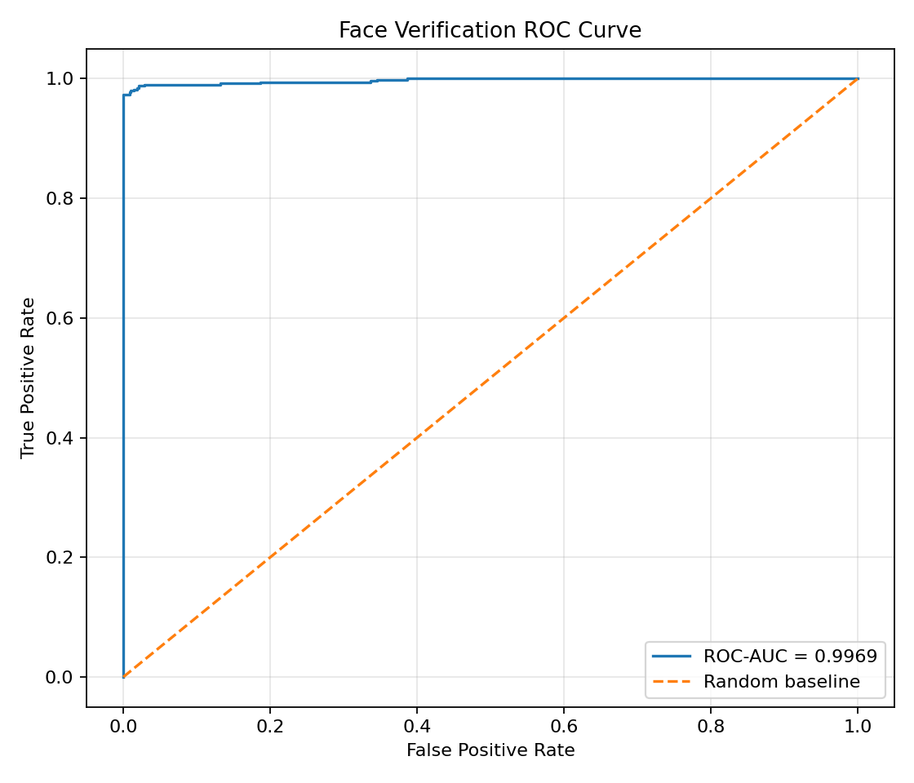
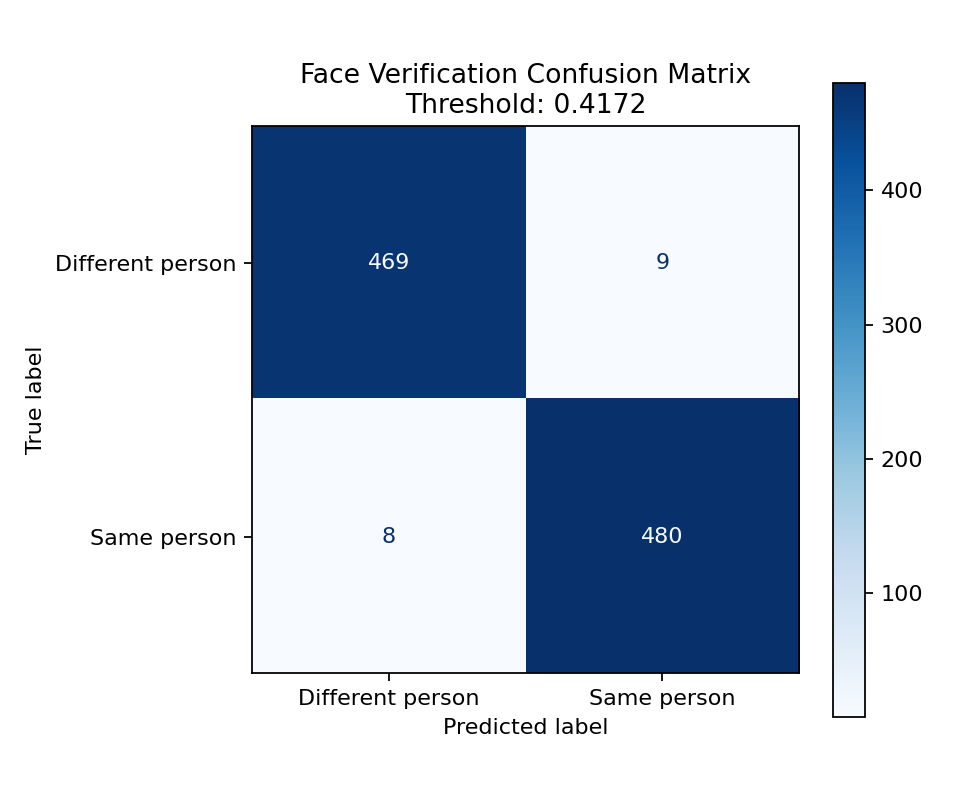
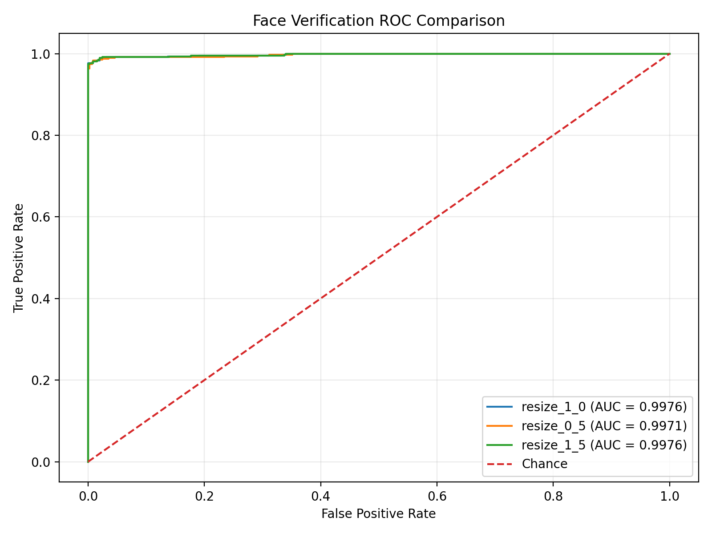

# FaceNet Face Verification

A face-verification application built with Python, PyTorch, FaceNet, MTCNN, and Streamlit. It compares two uploaded images and estimates whether they show the same person using facial embeddings and cosine similarity.

The project also includes an evaluation pipeline using the Labeled Faces in the Wild (LFW) dataset to measure model performance on face pairs.

## Features

- Upload two images through a Streamlit interface
- Detect and align faces using MTCNN
- Generate 512-dimensional face embeddings
- Compare embeddings using cosine similarity
- Evaluate face pairs using a development-set threshold
- Calculate accuracy, precision, recall, F1-score, FAR, FRR, and ROC-AUC
- Generate ROC curves and confusion matrices
- Save test predictions, metrics, and skipped-pair records

## Technologies

- Python 3.12
- PyTorch
- facenet-pytorch
- InceptionResnetV1 pretrained on VGGFace2
- MTCNN
- scikit-learn
- NumPy
- Matplotlib
- Streamlit
- Pillow

## Project Structure

facenet-face-verification/
├── evaluation/
│   ├── __init__.py
│   ├── dataset.py
│   ├── inspect_pair.py
│   ├── metrics.py
│   ├── run_comparison.py
│   ├── run_evaluation.py
│   └── test_detection.py
├── results/
│   ├── baseline_resize1/
│   ├── comparison/
│   │   ├── comparison_metrics.csv
│   │   ├── comparison_report.json
│   │   ├── comparison_roc.png
│   │   ├── resize_1_0/
│   │   └── resize_0_5/
│   ├── metrics.csv
│   ├── metrics.json
│   ├── test_predictions.csv
│   ├── skipped_pairs.csv
│   ├── roc_curve.png
│   └── confusion_matrix.png
├── src/
│   ├── app.py
│   └── facenet_model.py
├── tests/
│   ├── test_facenet_model.py
│   └── test_metrics.py
├── .gitignore
├── requirements.txt
└── README.md

The `comparison/` directory contains the outputs from the controlled input-resize experiment. Each configuration has its own metrics, ROC curve, confusion matrix, predictions, and skipped-pair records.

## Requirements

- Python 3.12
- pip

## Installation

Clone the repository and enter the project directory:

    git clone <YOUR_GITHUB_REPOSITORY_URL>
    cd facenet-face-verification

Create a virtual environment:

    python -m venv .venv312

Activate it in Windows PowerShell:

    .\.venv312\Scripts\Activate.ps1

Install dependencies:

     python -m pip install -r requirements.txt

The requirements file pins the main package versions used during development. PyTorch installation can vary by operating system and hardware. For a CPU-only setup, follow the official PyTorch installation instructions if pip cannot resolve a compatible build.

## Run the application

From the project root, run:

    python -m streamlit run src/app.py

The application opens in your browser. Upload two images containing faces to compare their embeddings.

## Run Automated Tests

The project includes automated tests for the FaceNet embedding workflow and evaluation metrics. The tests use mock objects where appropriate, so they do not need to download the pretrained model or run face detection for every test.

Run all tests from the project root:

    python -m pytest .\tests -v

The tests cover embedding output shape, RGB image conversion, face-detection errors, cosine similarity, threshold selection, metric validation, and evaluation plot generation.

The current test suite contains 13 tests. All 13 passed in the development environment.

## Run the evaluation pipeline

From the project root, run:

    python -m evaluation.run_evaluation

The evaluation pipeline uses LFW face pairs and separates threshold selection from final testing. The development subset is used to select the decision threshold, while the test subset is used to report final metrics.

The LFW dataset may need to be downloaded the first time the evaluation is run. An internet connection may be required for this initial download.

Evaluation outputs include metrics, test predictions, skipped-pair records, a ROC curve, and a confusion matrix. Exact output files depend on the evaluation script configuration.

## Evaluation Results

The current recorded test evaluation produced the following results:

| Metric | Result |
|---|---:|
| Test pairs evaluated | 966 |
| Test pairs available | 1,000 |
| Test coverage | 96.60% |
| Accuracy | 98.24% |
| Precision | 98.16% |
| Recall | 98.36% |
| F1-score | 98.26% |
| ROC-AUC | 0.9969 |
| False Acceptance Rate (FAR) | 1.88% |
| False Rejection Rate (FRR) | 1.64% |
| Approximate Equal Error Rate (EER) | 1.86% |
| Decision threshold | 0.4172 |

The threshold was selected using the development subset, not the test subset. The test results are based on the 966 pairs successfully processed; 34 of the 1,000 test pairs were skipped because at least one image could not be processed successfully.

These are the current recorded results for this configuration. Re-run the pipeline to reproduce them in your own environment.

### Evaluation Visualizations

**ROC Curve**

The ROC curve shows the trade-off between the true positive rate and false positive rate across decision thresholds.

**Confusion Matrix**

The confusion matrix summarizes correct and incorrect predictions on the evaluated test pairs.

## Input Resize Comparison

A controlled experiment was conducted to compare two LFW dataset input-resize settings while using the same pretrained InceptionResnetV1 model and MTCNN face detector.

### Experimental Setup

- **Dataset:** Labeled Faces in the Wild (LFW)
- **Model:** InceptionResnetV1 pretrained on VGGFace2
- **Face detector:** MTCNN
- **Configurations:** `resize=1.0` and `resize=0.5`
- **Development random state:** 42
- **Test random state:** 43
- **Threshold selection:** The decision threshold was selected using development data only.
- **Comparison method:** Metrics were calculated on the same test pairs successfully processed by both configurations.

### Results

| Metric | Resize 1.0 | Resize 0.5 |
|---|---:|---:|
| Common test pairs | 957 | 957 |
| Test coverage | 95.70% | 95.70% |
| Accuracy | 98.33% | 97.70% |
| Precision | 98.15% | 96.76% |
| Recall | 98.55% | 98.76% |
| F1-score | 98.35% | 97.75% |
| ROC-AUC | 0.9977 | 0.9972 |
| False Acceptance Rate (FAR) | 1.90% | 3.38% |
| False Rejection Rate (FRR) | 1.45% | 1.24% |
| Decision threshold | 0.4172 | 0.3810 |

### ROC Comparison

The following plot compares the two input-resize configurations using the same successfully processed test pairs.

### Interpretation

On this test subset, `resize=1.0` achieved higher accuracy, precision, F1-score, and ROC-AUC than `resize=0.5`. The smaller resize setting achieved slightly higher recall and a lower false rejection rate, but also a higher false acceptance rate.

The ROC-AUC values were close, so the difference between these configurations should not be overstated. These results describe this experiment only and do not establish that one resize setting is universally better.

### Reproduce the Comparison

Run the following command from the project root:

python -m evaluation.run_comparison

The comparison outputs are saved in `results/comparison/`, including `comparison_metrics.csv`, `comparison_report.json`, and `comparison_roc.png`.

Some pairs may be skipped when a face cannot be detected or processed. The report records the evaluated pairs and coverage, so results should be interpreted alongside these values.

## Understanding the Results

- **Accuracy:** Proportion of evaluated pairs classified correctly.
- **Precision:** Proportion of predicted same-person pairs that were actually same-person pairs.
- **Recall:** Proportion of actual same-person pairs correctly identified.
- **ROC-AUC:** Measures how well similarity scores distinguish same-person and different-person    pairs across thresholds.
- **FAR:** Proportion of different-person pairs incorrectly accepted as a match.
- **FRR:** Proportion of same-person pairs incorrectly rejected.
- **EER:** Approximate error rate at the point where FAR and FRR are similar.

## Limitations

- The face-recognition network uses pretrained weights; it was not trained from scratch for this project.
- LFW is a benchmark dataset and does not represent every real-world environment or population.
- Some low-resolution, cropped, or difficult images may fail face detection and are excluded from the reported test metrics.
- Reported performance applies only to the evaluated pairs and configuration. It should not be assumed to represent performance on arbitrary uploaded images.
- This project is intended for learning and research, not security-critical identity verification or decisions about access, eligibility, or individuals.

## Future Improvements

- Add more configurable experiments and improve experiment tracking for repeatable evaluation.
- Compare different image preprocessing and threshold-selection strategies.
- Evaluate additional datasets and report performance across relevant subgroups.
- Add experiment tracking and more detailed error analysis.

## License and Dataset

Check the licensing terms of the model weights, dependencies, and LFW dataset before redistributing them or using this project commercially.
